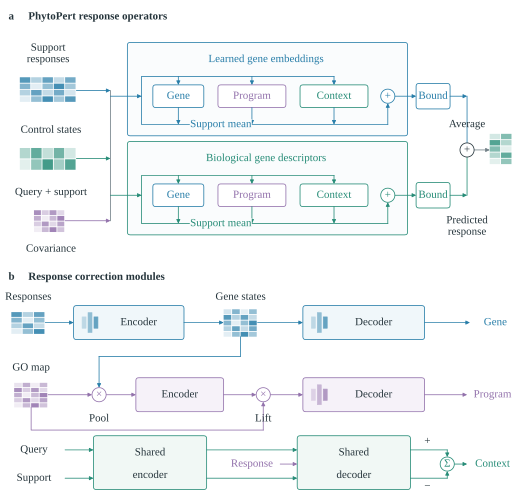

# Architecture and training

PhytoPert combines two conditional neural response operators with equal weight. One uses a learned 16-dimensional gene embedding. The other encodes 15 descriptors: membership in 12 functional gene sets, two training-control summary features and one training-response scale feature. Its descriptor projection has 16 outputs.

Each operator combines four additive components: the mean measured support effect, gene corrections, functional-program corrections and a cell-context correction. The cell-context module compares query and pooled support control states using shared encoders and a shared response-conditioned decoder. Sampling-covariance features encode support precision and dependence from shared samples.

| Module | Input → hidden → output width |
|---|---|
| Gene encoder | 27 → 64 → 16 |
| Gene decoder | 55 → 64 → 2 |
| Program encoder | 28 → 32 → 16 |
| Program decoder | 67 → 64 → 2 |
| Context encoder | 18 → 32 → 16 |
| Context decoder | 121 → 64 → 2 |

Hidden layers use GELU. Neural response corrections use a zero-effect anchor, `H(z, e) = h(z, e) - h(z, 0)`. This makes learned response corrections vanish when the measured support effects are zero. Each operator constrains its predicted treated expression to `[0, log(10001)]` and detection fraction to `[0, 1]`, then returns the treated-minus-control response. The final response averages the two constrained outputs.

The learned-embedding operator has 79,074 parameters and the descriptor operator 21,746, totalling 100,820. Both operators include their own gene, program and context modules.

## Training formulation

Training samples episodes from biological response units, with query and support populations separated by cell-type and replicate labels. Query treatment outcomes provide supervision during fitting. Functional memberships and normalization assets are calculated for the fitting scope and frozen during prediction.

The loss combines expression response error scaled by training-gene response variance with 0.1 times detection-response squared error. It includes ordinary response episodes, paired marginal responses and differences between paired query responses, each weighted by 0.5. Finite-cell support sampling exposes the model to variation in measured population summaries. The final model does not include an intervention-contrast loss term.

Optimization uses AdamW, learning rate 0.0001, weight decay 0.01, batch size 8, gradient clipping at norm 1 and random seed 42. The learned-embedding operator receives 6,000 finite-cell training updates after its initial selected fit. The descriptor operator receives 12,000 updates from initialization. The released checkpoint combines the fitted operators with a fixed weight of 0.5.

This repository provides the fitted inference model, preprocessing helpers and architecture implementation. Full benchmark data preparation and the complete experimental training pipeline are not included in this inference release. The portable checkpoint contains numeric arrays only, with no optimizer state or executable pickle objects.
